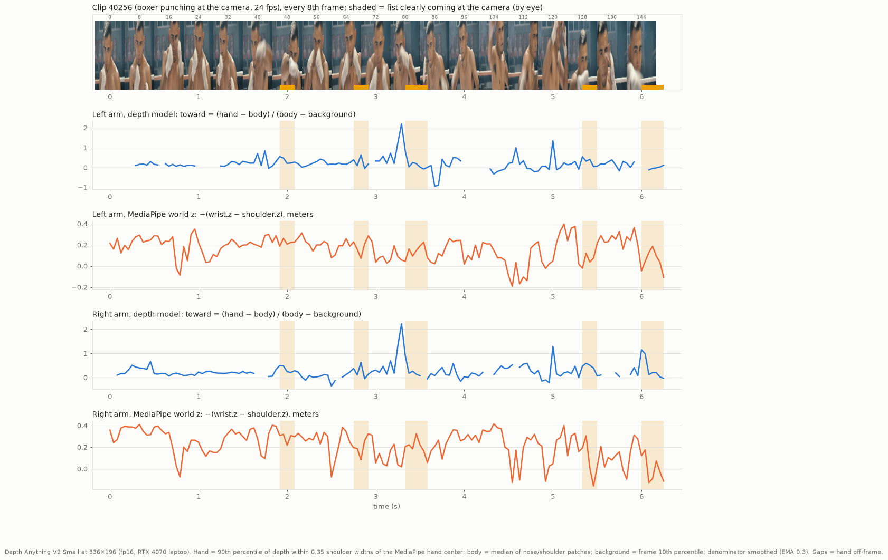

# Depth spike: can a monocular depth model see a punch coming at the camera?

## Verdict

- **It sees the punch; MediaPipe z doesn't.** On the boxer clip, Depth Anything V2 Small's toward-camera signal stays flat while the hands are in guard and spikes when a fist comes at the camera. MediaPipe's world z shows no punch response at all, and its values often move the wrong way.
- **It isn't clean or cheap enough to rely on.** Moderate punches peak at about the same level as the busiest non-punch frames. The two arms get mixed up when the hands are close together, and small punches only show at 336 px or more. On a strong integrated GPU it runs at **5–9 fps next to MediaPipe** and pulls **pose down from 24 to 17–20 fps**. The WASM fallback takes 0.2–0.7 s per frame.
- **Recommendation: don't integrate it now.** Keep the 2D elbow-lift/extension detector. Keep `/test/depth/` to re-check on a real webcam recording, on a laptop with a discrete GPU, or with a lighter model. If we ever add it, it should be an optional confirm signal that turns on only when WebGPU is fast enough, and the reader must behave exactly as today without it.



## What was built

- `test/depth/` (`npm run dev` → `/test/depth/`). It takes webcam frames through `CameraSource` (MediaPipe) and every 2nd pose frame (or whenever the worker is free) sends a downscaled `ImageBitmap` to a **Worker** that runs Depth Anything V2 Small (`onnx-community/depth-anything-v2-small`, Transformers.js 4.3.0, WebGPU fp16, WASM q8 fallback). The worker samples depth at the landmarks and returns the samples plus frame percentiles. The page shows a depth overlay toggle, rolling plots of the depth signal next to MediaPipe world z for each arm, pose fps, depth fps, inference ms and backend. **Record** downloads JSONL in the tuner clip format (`t, aspect, image, world`) with an extra `depth` field (`samples, pct, toward, ms, w, h`). URL parameters:
  - `res=196|252|336|518` (long side, default 336)
  - `every=N`
  - `device=auto|webgpu|wasm`
  - `dtype=fp16|fp32|q8`
  - `depth=off` (MediaPipe alone, as a baseline)
  - `bench=1` (depth only on a synthetic frame, no camera)
- `scripts/build-depth.mjs` builds `dist/depth/` (base `/depth/`, `index.html` at the root). The build includes ORT's 27 MB wasm. The model (about 50 MB fp16) is fetched from the Hugging Face Hub on first use and then cached by the browser.

## The signal (and why)

Depth Anything outputs **relative inverse depth**: bigger values are closer, and the scale and shift change from frame to frame. Only ratios of differences are meaningful:

```
toward = (hand − body) / (body − background)
hand       = 90th percentile of depth within ±0.35 shoulder widths of the MediaPipe hand center (wrist, index, pinky)
body       = median of small patches at the nose and both shoulders
background = 10th percentile of the whole frame
denominator smoothed across frames (EMA 0.3), floored at 0.25 × (p95 − p5)
```

With a far background, this is roughly `Z_body / Z_hand − 1`. It reads 0 with the hand at face depth, about 0.2–0.3 with a guard held slightly in front of the face, and 1 with the fist twice as close as the face. I compared six variants on the clip (scratch plots kept outside the repo):

- **A small patch median at the wrist or hand (the obvious first try) is worse.** On a blurred fist, the landmark lags or lands on the forearm or the background. The fist is the closest thing near the hand, so a high percentile over a window finds it even when the landmark is off.
- **A chest reference failed in close framing.** The chest point was often below the frame or on the ring rope, which produced long false plateaus. A nose/shoulder median is always visible and survives one bad point.
- **A per-frame denominator gave one-frame spikes** whenever the background was briefly blocked. Smoothing it over about 3 frames fixed that without delaying the numerator.
- Rank or percentile normalization saturates, and `hand/chest − 1` (which ignores the shift) blew up to 40–50. Neither was usable.
- Apparent hand size from MediaPipe (wrist→index/pinky over shoulder width) was also tried as a free 2D cue. It was noisy and not clearly better.

## Offline evidence (clip 40256, 151 frames, 24 fps, boxer punching at a handheld camera)

Depth was computed with PyTorch `depth-anything/Depth-Anything-V2-Small-hf` on the RTX 4070 laptop GPU, sampled at the clip's MediaPipe landmarks. The shaded bands in the plot are frames where a fist clearly comes at the camera, judged by eye. They are approximate and not split by arm.

| at 336×196 | median outside bands | p95 outside bands | peak in each band |
|---|---|---|---|
| depth `toward` | 0.22 | 0.71 | 0.55, 0.64, 0.92, 0.59, 1.63 |
| MediaPipe −(wrist.z − shoulder.z), m | 0.28 | 0.39 | 0.32, 0.32, 0.32, 0.31, 0.19 |

- **Depth:** the biggest punches stand far above the baseline: 2.2 at frame 79 (just before my band), 1.6 at frames 144–148, 1.3 at frame 120. The out-of-band frames above 0.8 (42, 78–79, 110, 120) look like real punches I didn't band. Moderate punches (0.55–0.65) sit at the level of the non-punch p95, so they are visible on the plot but not separable with a single threshold. When both hands are near each other, both arms spike together (frames 78–80).
- **MediaPipe z:** inside the bands its values sit *below* its own median. The wrist z often swings 0.3–0.5 m with no punch, and on real punches (frames 128–150) it goes negative, which is the wrong direction.
- **Resolution matters.** At 252×140 the baseline is quieter (median 0.10, p95 0.45), but band peaks shrink to 0.14–0.47. Only the biggest punch (1.8) stands out, because a fist is about 10 px tall at that size. 336 px is the floor for this framing.
- **Frame rate matters.** A punch's peak lasts 1–3 frames at 24 fps. Keeping only every 2nd frame mostly kept the peaks at 336 px. At the 5–9 depth fps measured in the browser, a straight punch gets 0–1 depth samples.
- **Caveats:** this is one cinematic, handheld, very close-up clip, the ground truth is by eye, and the browser model (ONNX fp16/q8) was not checked frame by frame against PyTorch. A webcam recording made with the test page is the next thing to look at.

## Speed

**GPU, offline** (PyTorch, RTX 4070 laptop, WSL2, batch 1). The time is overhead-bound: it barely changes with input size, so the GPU is mostly idle.

| input | GFLOP/frame | fp16 | fp32 |
|---|---|---|---|
| 252×140 | 11.2 | 16 ms | 17 ms |
| 336×196 | 21.9 | 13 ms | 13 ms |
| 336×252 | 28.9 | 11 ms | 12 ms |
| 518×294 | 57.0 | 12 ms | 15 ms |
| 518×392 | 80.9 | 12 ms | 29 ms |

**Browser, real iGPU.** Windows Chrome 155 in headless=new mode on this laptop, WebGPU fp16. Chrome picked the **integrated AMD RDNA3 GPU** (`powerPreference` is ignored on Windows), so these are real iGPU numbers. The fake camera fed the clip at 640×360, 24 fps.

| run | pose fps | MediaPipe ms | depth fps | depth model ms |
|---|---|---|---|---|
| MediaPipe alone (`depth=off`) | 23–24 | 22–25 | – | – |
| depth alone, 252×196 (`bench=1`) | – | – | 24 | 37 |
| depth alone, 336×252 | – | – | 16–17 | 55 |
| depth alone, 518×392 | – | – | 8 | 122 |
| MediaPipe + depth 252×140, every 2nd | 17–20 | 29–37 | 6–9 | 65–72 |
| MediaPipe + depth 336×196, every 2nd | 17–21 | 33–37 | 5–8 | 73–97 |

- The two models compete for one GPU. Depth inference roughly doubles in time, and MediaPipe slows by about 10 ms per frame. On the host laptop, Three.js renders on the same GPU as well.
- An RDNA3 iGPU (780M class) is near the top of integrated GPUs. A typical Intel Iris Xe is about 1.5–2× slower, so I'd expect **3–5 depth fps alongside MediaPipe, with pose dropping into the mid-teens**. That is an estimate, not a measurement.

**Headless Linux Chrome** (Playwright headless shell, no GPU, SwiftShader): no WebGPU adapter, so the page falls back to WASM. The page loads with **0 console errors** (MediaPipe itself runs at about 2 fps in software GL). Depth-only WASM timings:

| input | q8, 1 thread | fp32, 1 thread | q8, threads | fp32, threads |
|---|---|---|---|---|
| 196×154 | 321 ms | – | – | – |
| 252×196 | 480 ms | 679 ms | 210 ms | 303 ms |
| 336×252 | 733 ms | – | – | – |
| 518×392 | 1139 ms | – | – | – |

Threads need COOP/COEP headers (cross-origin isolation). This rules out a CPU fallback.

`npx tsc` is clean, and `node scripts/build-depth.mjs` builds.

## Costs and risks

- **GPU contention.** This is the deciding cost: it slows the pose tracking that every move depends on.
- **Latency and sampling.** Results arrive one inference late (40–100 ms in the browser). At 5–9 fps, depth often misses the 100–150 ms window when a straight punch peaks.
- **Download.** About 50 MB of model (fp16) on first load, plus 27 MB of ORT wasm in the bundle (or from a CDN).
- **Signal failure modes:**
  - arm attribution when the hands are close together
  - small fists at low resolution
  - scale jumps when the background is blocked (mitigated by the floor and the EMA)
  - a close, uniform background, such as sitting against a wall, shrinks the denominator
- **Platform.** WebGPU is needed: Chrome or Edge, Safari 26+, Firefox only partly. Without it, the only option is to turn depth off.
- **License.** Depth Anything V2 **Small** is Apache-2.0. Base and Large are CC-BY-NC, so it must stay on Small.

## If we go ahead anyway: how it plugs into the intent reader

1. **Source.** Add `src/input/depth/DepthAssist.ts`, which owns the worker from `test/depth/depthWorker.ts` and the `TowardSignal` from `test/depth/signal.ts`.
   - `CameraSource` would get an optional `depth` hook. After each detection, it posts the frame and samples, never waiting on the result.
   - The latest result is attached to outgoing frames as `PoseFrame.toward?: { t: number; L: number; R: number }`, an optional field in `src/types.ts`, stamped with the time of the frame it was computed on.
   - DepthAssist starts only if WebGPU exists and a 2 s self-benchmark gives at least 12 fps at 336 px with pose staying at 25 fps or more. Otherwise it stays off.
2. **P2.** The client laptop runs its own DepthAssist and sends `toward` inside the pose message in `net/protocol.ts`. The host never runs depth for P2.
3. **IntentReader**, arms only, in `updateLimb`:
   - Keep `towardRest` per arm, updated like `s.rest` while idle. Compute `rise = toward − towardRest` only when `frame.t − toward.t < 120 ms`.
   - **Onset:** add `rise > cfg.depth.onset` (about 0.3) as a third trigger next to `strikeLike` and `extensionStrike`, still requiring `outward > onsetSpeed` so a held guard can't fire.
   - **Confirm:** track `peakRise`. A strike with `peakRise > cfg.depth.confirm` (about 0.45) counts as straight even when the elbow cue is weak. An `extensionStrike` with fresh depth and `peakRise < 0.1` is cancelled, which catches raising the guard and arms straightening downward.
   - **Arm attribution:** when both hands are within half a shoulder width of each other, give the rise to the arm whose image-plane speed is higher.
   - New `DEFAULT_INTENT.depth = { onset, confirm, maxAgeMs }` thresholds, with matching sliders in the tuner.
4. **No depth: no change.** With `toward` undefined, the reader must behave byte-for-byte as it does today. The existing vitest clips guard that.

## Cheaper ideas, untested

- Run depth only on an **upper-body crop**: the same fist pixels at a third to half the cost.
- Run it **on demand**: only for the 2–3 frames after an elbow onset, to confirm or cancel.
- Try a **lighter depth model**, for example MiDaS v2.1 small at 256 px.
