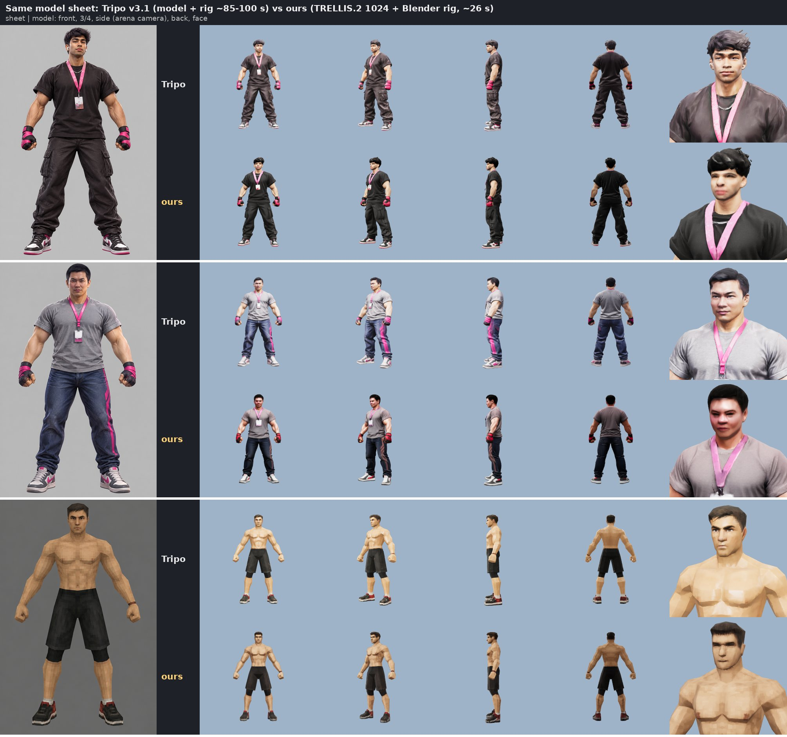
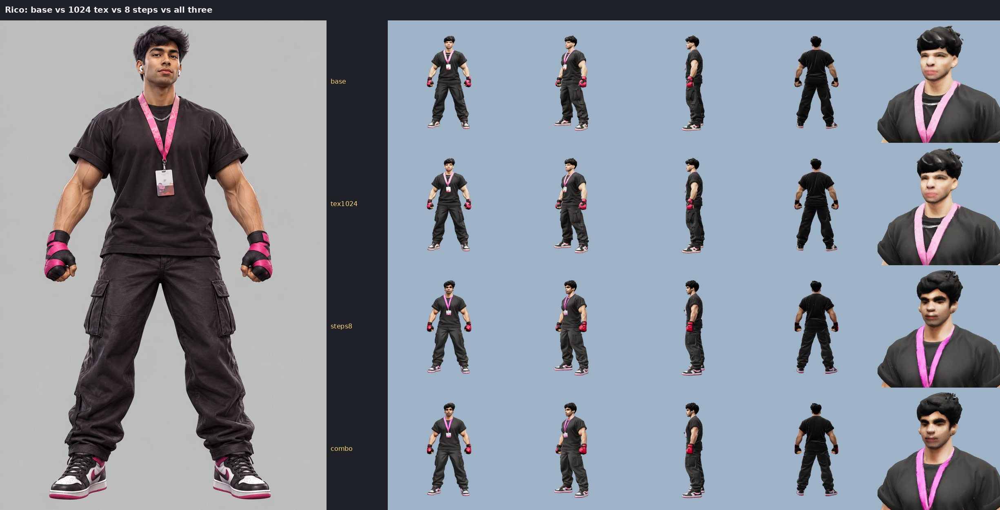
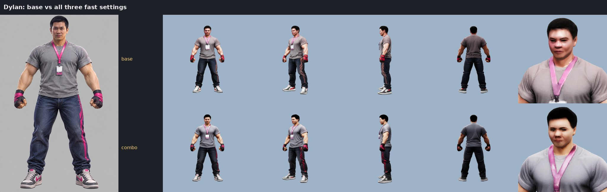
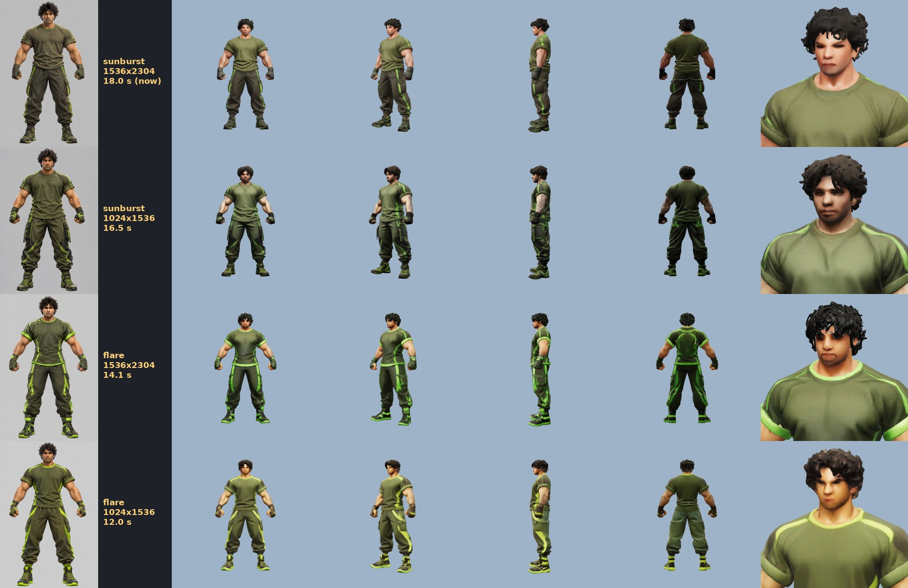
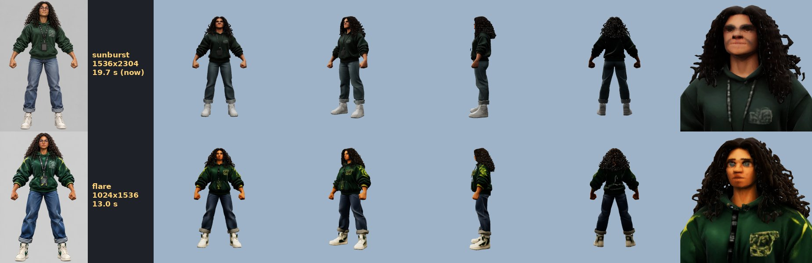
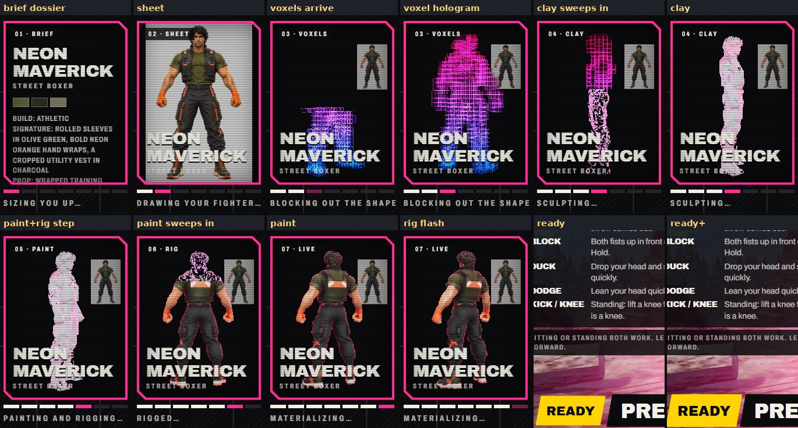
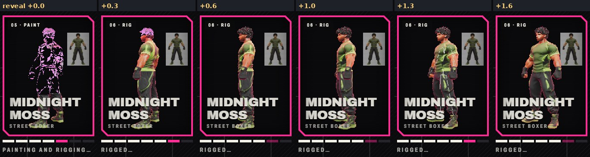

# Forge GPU: our own image-to-3D and rig instead of Tripo

**Result:** the forge's 3D step now runs on our own GPU box: TRELLIS.2 for the textured model and a Blender
Mixamo rigger. It takes **about 26 s on the box and 30 s door to door, vs. 85-100 s for Tripo's model + rig**, and it
costs no credits (Tripo's ran out tonight). A real forge through the live site took **59 s from scan to ready**
(was about 110-150 s). The game gets the same kind of `rigged.glb` as before: Mixamo bones, upright, optimized.
Bodies, costumes and silhouettes are on par with Tripo. **Faces are clearly softer** (see below).



*Each row pair: the model sheet, then Tripo's model (top) and ours (bottom) from the front, 3/4, side (the arena
camera), back, and a face close-up. Same sheets, both rigged.*

## Update 2026-10-18: a 35 s forge, and a live preview while it forges

**Result:** a forge now takes **about 35 s on the server** (brief 1.9-2.6 s, sheet 11.4-11.6 s, GPU 20.2-21.9 s,
optimize 0 s), down from 59 s. A real scan is **ready in the game at 38-39 s**, including a 2.2 s reveal in the
forging card that overlaps the model download. That was measured on 3 real forges: game → local forge server → a
dev twin of the GPU box. There's no visible quality loss at fight distance (images below). While it forges, the card
now shows the forge working: the brief typed out as a scouting dossier, the sheet developing, a voxel hologram
building up, the clay sculpt, the paint sweeping in and the rig flashing.

| | Before (live, 2026-10-17) | Now | What changed |
|---|---|---|---|
| Brief | 1.6 s | 1.9-2.6 s | nothing (gpt-5.4-mini) |
| Sheet | 21.3 s | **10.7-13.0 s** | gpt-image-2.5-flare at 1024x1536 instead of sunburst at 1536x2304, on the GPU path only (`FORGE_GPU_SHEET=0` brings the old sheet back) |
| GPU: generate | ~10 s | **6.4-8.9 s** | TRELLIS.2 at 8 sampler steps instead of 12 |
| GPU: bake + export | ~12.5 s | **5.3-7.0 s** | a 1024 texture instead of 2048, and 40k faces instead of 60k |
| GPU: rig | ~3.3 s | 2.1-2.8 s | same rigger, smaller textures to read and write |
| GPU: optimize | (on the forge box) | **0.8-1.2 s** | `optimize.js` now runs on the GPU box (faster x86 CPU), so the forge box downloads ~1 MB instead of ~11 |
| GPU, door to door | 30.2 s | **18-22 s** | all of the above |
| Optimize (forge box) | 5.0 s | **0 s** | the GLB arrives optimized; the card/sheet WebP copies are made as soon as each exists, next to the 3D step |
| **Total, server** | **~59 s** | **~35 s** | |

Rejected levers: no remesh in the bake was *slower* (11 s). Starting TRELLIS on the sheet's streamed partial
would save ~6 s, but the partial lacks the final's costume details (accent stripes, shoes), so the fighter would
lose them. Low image quality doesn't speed up the sheet (17.6 s vs 18.0 s). One sheet in nine took 61 s at OpenAI's
end; that's their variance, not ours.

### Same fighter, faster settings





*Same sheets, from the top: the old settings (12 steps, 60k faces, 2048 texture), a 1024 texture only, 8 steps only,
and all three (now the default). Bodies are identical at every distance. The 1024 texture's face matches the 2048
one: TRELLIS.2's texture detail is capped by its voxel attributes, not by the bake size. 8 steps gives a different
face (another sample), not a worse one.*

### The sheet: flare 1024x1536 vs sunburst 1536x2304





*The same brief drawn each way, then built with the new GPU settings. Flare draws bolder accents (neon trim), and
the fighters hold up as well or better (second person: a cleaner face). TRELLIS.2 reads the sheet at 1024 px tall
anyway, so the bigger sunburst sheet only bought Tripo detail. Flare doesn't always stream a partial; when it
doesn't, the dossier fills the wait. With Tripo (no `FORGE_3D`) the forge keeps sunburst 1536x2304.*

### The live preview





*The forging card in Edge on the RTX 4070, from a real forge (2026-10-18). Top: the brief typed out as a dossier
with the brief's palette, the sheet, the voxels arriving and building up as a hologram, the clay sculpted in over
them. Bottom: painting and rigging, then the finished fighter's paint sweeping in over the clay, and the rig
flashing (white bone lines at +1.3 s). Then the arena's own materialize takes over.*

How it works:

- **The sheet's partials:** the forge asks OpenAI for streamed partial images (`stream`, `partial_images=3`; sunburst
  and flare both send one, ~3-6 s before the final, when they have time). Each goes out as a ~30 KB WebP
  (`sheetPartialUrl`). If the model refuses to stream, the sheet is drawn the plain way.
- **The GPU box's intermediates:** TRELLIS's stage 1 sparse voxels (~3-4 KB: a uint16 resolution, then x, y, z
  bytes) about 4-5 s into the job, and the untextured shape, decimated to 12k faces (~200-300 KB GLB), about 8-10 s
  in. The shape is decoded once, early, and reused for the final model, so this costs ~0.2 s. The forge relays them
  into the fighter's folder as `previewVoxelsUrl` / `previewMeshUrl`, the same way as the other files (public by
  fighter id, immutable).
- **The game:** `players[id].forge` (`ForgePreview`) on the host; the host forwards it to the client laptop in its
  `fighter` message, so the 1v1 client's card shows the same stages. One small WebGL renderer (288x384, low-power, no
  antialias) is shared by every forging card, exists only while a card shows 3D, and renders at 12 fps; that's also
  the stepped, arcade look. Each frame is copied onto the card's own 2D canvas. `?quality=low` (phones) gets the
  same stages as Canvas 2D points, with no WebGL at all.
- **Without intermediates** (Tripo, the ZeroGPU Space): the card shows the dossier, then the sheet, then the
  reveal, as before.

### Deploy

GPU box (`i-02b680f2662c0b82f`). It restarts the service, which takes ~4 min to be ready; forges in that window fall
back to Tripo:

```
# from the repo, on a machine that reaches bingus:
tar czf forge.tgz --exclude=forge/data --exclude=forge/node_modules forge   # the whole forge/: the box runs optimize.js
scp forge.tgz malhotan@bingus:/tmp/ && ssh malhotan@bingus
scp -i ~/.ssh/brawlegle-gpu.pem /tmp/forge.tgz ubuntu@54.161.35.172:
ssh -i ~/.ssh/brawlegle-gpu.pem ubuntu@54.161.35.172
rm -rf forge && tar xzf forge.tgz
sudo sed -i 's/^FORGE3D_STEPS=.*/FORGE3D_STEPS=8/; s/^FORGE3D_FACES=.*/FORGE3D_FACES=40000/; s/^FORGE3D_TEXTURE=.*/FORGE3D_TEXTURE=1024/' /etc/forge3d.env
sudo bash forge/gpu/setup.sh      # installs Node 22 + the optimizer (~1 min), copies the app, restarts forge3d
curl -s localhost:8790/health     # "ready": true after ~4 min
```

Forge box: deploy `forge/` from this branch as usual (`forge/deploy/setup-forge.sh`), with no env changes needed.
`FORGE_3D=local` turns on the flare sheet and the previews. Either order works: an old GPU box just sends no previews
and an unoptimized GLB, which the new forge optimizes itself as before. Then build and deploy the game (the forging
card). `FORGE_GPU_SHEET=0` in `/etc/brawlegle/forge.env` brings back sunburst 1536x2304 if you'd rather keep it.

## Timings (2026-10-17, the first version)

| | Tripo (before) | Ours (g6e.xlarge, L40S) |
|---|---|---|
| Image to textured model | ~75-90 s (v3.1, standard geometry, 40 credits) | **8.9-10.4 s** generate + **10.3-13.4 s** bake/export (TRELLIS.2 1024 cascade, 12 steps, 60k faces, 2048 px) |
| Rig | ~8 s (25 credits) | **2.8-3.3 s** (MediaPipe on the sheet, next to generation, + Blender) |
| 3D step, door to door | 83-97 s (live logs) | **26-31 s** (3 sheets, forge client to rigged GLB) |
| Whole forge, live site | ~110-150 s | **59 s**: brief 1.6, sheet 21.3, model + rig 30.2, optimize 5.0 (card in parallel) |
| Rig-only rescue (an existing model) | n/a | 11 s door to door (3.4 s on the box) |

**The first job after the service starts runs once at ~105 s**: FlexGEMM tunes its sparse-conv kernels for the new
shapes. The tuning is saved (`/root/.flex_gemm/autotune_cache.json`) and reloaded, so after one real job it stays
fast, restarts included. The service is ready about 2.5 min after it starts (weights load in ~110 s, then two
warm-up runs).

## Quality

- **On par:** silhouette and proportions (the SF6 exaggeration survives), costume shapes and colors, shoes, the side
  and back views (both rebuild the back from one front image). Ours keeps the sheet's darker values a little
  better (black cargo pants vs Tripo's washed-out gray).
- **Worse:** faces. TRELLIS.2's 1024 texture is soft at face scale: eyes and mouth smear, skin gets blotchy. Hair
  comes out as a smooth helmet. Small high-contrast details can drop (row 2's pink jeans stripe). At fight distance
  (fighters fill ~40-90% of the screen height) it reads fine; in the VS card and close-up replays the face is the
  weak spot.
- **Rig:** same deformation quality as Tripo's rig on the same mesh ([rig-vs-tripo.jpg](forge-gpu/rig-vs-tripo.jpg)).
  Checked in the game's own FighterView on a recorded clip: upright, guard, punches, footwork.

**Next for faces**, in order of effort:
1. Bake at 4096 (`FORGE3D_TEXTURE=4096`, a few seconds more).
2. Project the sheet's own pixels onto the front-facing texels. The sheet is a straight-on front view, so the face
   region maps almost 1:1; this is what Tripo's `texture_alignment: original_image` does.
3. Try Pixal3D (a pixel-aligned TRELLIS.2 fine-tune that can also use a back view) at 1024.

## Model choice: TRELLIS.2-4B

| | Output | Speed (published) | VRAM | License | Verdict |
|---|---|---|---|---|---|
| **TRELLIS.2-4B** (Microsoft, Dec 2025) | textured PBR GLB, one model | H100: 3 s at 512, 17 s at 1024 cascade | 24 GB+ | MIT | **picked**: the only open model with textures fast enough |
| Pixal3D (Tencent ARC, 2026) | TRELLIS.2 fine-tune, front + back | not published | same | MIT | next to try (sharper, back view) |
| Hunyuan3D-2.1 / 2mini | shape + separate paint model | paint alone ~60 s+ | 16-29 GB | Tencent community (no EU/UK/KR) | too slow |
| SF3D / SPAR3D (Stability) | textured, under 1 s | very fast | 6-10 GB | community | much weaker, esp. the back |
| TripoSG, Direct3D-S2, Hi3DGen | shape only | | | | no texture |
| Step1X-3D | textured | ~150 s | 27 GB | Apache | too slow |

Two parts of TRELLIS.2's stock pipeline are gated or non-commercial, so they're swapped for open ones (`weights.py`
patches `pipeline.json`, `gen3d.py` registers the extractor):

- **DINOv3 ViT-L/16** comes from timm's ungated copy (`timm/vit_large_patch16_dinov3.lvd1689m`), not Meta's
  manually approved repo. Same weights, same license. Our extractor's forward matches timm's own exactly.
- **Background removal** uses `ZhengPeng7/BiRefNet` (MIT) instead of `briaai/RMBG-2.0` (non-commercial). It loads
  in fp16 but TRELLIS.2 feeds it fp32, so we cast it back.

TRELLIS.2 defaults to `low_vram` (each model moved onto the GPU only while it runs). On a 48 GB card we keep them all
resident. It needs ~14 GB of host RAM to load, which rules out the team's 16 GB laptops (OOM on the RTX 4070).

## Rigging: a Mixamo template fit

Tripo can rig uploaded models, but that keeps the credit problem. The open auto-riggers don't give Mixamo names:
UniRig's Mixamo template is untrained, and Make-It-Animatable needs a gated dataset for its template. Our sheets are
always a straight-on front A-pose, so a template fit is enough (`rig_blender.py`, headless Blender 5.2):

1. **Joints:** MediaPipe Pose (heavy) on the sheet. It found every joint on all 5 sheets checked by eye, including the bulky SF6
   ones. If it ever finds no body, average A-pose proportions take over.
2. **Onto the mesh:** the sheet's character box maps onto the mesh's front view. Each joint's depth is the middle
   between the front and back surface there. The model is first turned to face +x: the arm span gives the side axis
   and the feet stick out in front of the shins. Checked from all four starting yaws. It's then scaled to 1 m with the
   feet on y = 0, like Tripo's.
3. **Skeleton:** the Mixamo hierarchy with `mixamorig:` names (Hips, Spine, Spine1, Spine2, Neck, Head, Shoulder,
   Arm, ForeArm, Hand, UpLeg, Leg, Foot, ToeBase).
4. **Skin:** Blender bone heat on a watertight 8 mm voxel copy, copied back to the real mesh, max 4 bones per vertex.
   Bone heat failed for every bone until the copy was cleaned: merge doubles, dissolve degenerate faces,
   triangulate, keep the biggest piece. Materials are forced opaque.
5. **Checked, with fallbacks:** see below.

The same rigger also rescues fighters whose rig failed. `forge/gpu/rescue.mjs` sends the existing model plus its
sheet as a rig-only job (or installs a GLB rigged elsewhere with `--glb`), checks it with `forge/rigcheck.js` and
only then installs it, keeping `*.pre-rescue` backups. That's how havel got rigged, and how dylan, lamdestroyer and
lampham got fixed.

### Rigs that collapsed onto one bone (fixed)

Three of 14 GPU rigs (dylan HQ, lamdestroyer, lampham) came out with nearly all the weight on one bone: Spine1 owned
75% of dylan, RightLeg 97% of lamdestroyer, LeftUpLeg 43% of lampham. The joints were fine; the skin wasn't.

- **Cause:** TRELLIS.2's meshes are hollow: a 2-3 mm double-walled shell around an empty inside (every ray through the
  torso crosses four surfaces, not two). Whether OpenVDB's 8 mm voxel remesh fills that inside depends on the shell.
  On these three it didn't (dylan's inside reaches the outside through a 12-16 mm gap at the crotch), so the remesh
  traced the 2-3 mm shell itself, which is thinner than a voxel, and came out as ~1,200-1,300 separate blobs with
  half the surface area. "Keep the biggest piece" then kept one blob, a 1.8k-3.2k-face patch of chest or thigh (good
  proxies have 31k-44k faces). Bone heat on that patch reached 3-9 of the 22 bones, and the copy-back gave every
  vertex the patch's weights. The rigger reported `heat_empty` (13-19 bones) but nothing read it.
- **Fix (`rig_blender.py`, `rig_check.py`):** the proxy must cover the body and stay in one piece, and the weights
  must pass a check (each limb's vertices owned by that limb, each body part's share near what its geometry gives it,
  no bone owning the mesh). Otherwise the next path: bone heat on a solid built by voxel flood fill (the surface
  thickened by a voxel to close gaps, everything the outside can't reach filled), then envelope weights (nearest bone
  segment, blended over 3 cm at each joint, smoothed over the surface). The box then runs the game's rig check and
  tries the next attempt plan if it fails. The 19 rigs that were fine come out byte-identical.

## The box

| | |
|---|---|
| Instance | `i-02b680f2662c0b82f`, **g6e.xlarge** (NVIDIA L40S 48 GB, 4 vCPU, 32 GB RAM, 200 GB gp3), **us-east-1d** |
| Address | Elastic IP **54.161.35.172**, service on port 8790 |
| Why there | us-west-2 had no L40S capacity in any zone tonight (g6e.2xlarge and g6e.xlarge), us-east-1 only in 1d. Cross-region adds ~70 ms per call. |
| Image | Deep Learning Base OSS Nvidia Driver GPU AMI (Ubuntu 22.04), CUDA 12.9 toolkit, torch 2.6 (cu124) |
| Cost | **$1.86/h** on-demand while running (~$45/day). Stopped: ~$1.65/day (the 200 GB gp3 disk with its extra IOPS/throughput, plus the idle Elastic IP) |
| Security | Own security group: port 8790 only from the brawlegle box (54.149.60.196) and bingus; SSH only from bingus. Key pair `brawlegle-gpu`, private key only on bingus (`~/.ssh/brawlegle-gpu.pem`). Every call also needs `x-forge3d-key` (`FORGE3D_KEY` in the box's `/etc/forge3d.env`, root only). Everything is tagged `Project=brawlegle`. |
| Service | systemd `forge3d` (restarts on failure, starts on boot); logs: `journalctl -u forge3d` |

**Stop and start** (on bingus, `cd ~/brawlegle-gpu/gpu`): `FORGE3D_REGION=us-east-1 bash aws.sh stop` and
`... start`. After a start the service is ready in ~4 min (boot plus warm-up). While it's stopped, the forge's
3-second health check fails and it falls back to Tripo (no credits right now, so the fighter gets the default body).

**Auto-stop overnight:** the box can power itself off; an EBS instance stops, it isn't terminated. For example
`FORGE3D_REGION=us-east-1 bash aws.sh ssh 'sudo shutdown -h 09:00'` stops it at 2 AM Pacific (the box runs on UTC).
`sudo shutdown -c` cancels. Starting it again is `aws.sh start`. Nothing was scheduled.

**Switching the live forge** (done tonight): `FORGE_3D=local`, `FORGE_3D_URL=http://54.161.35.172:8790`,
`FORGE_3D_TIMEOUT=180`, and `FORGE_3D_KEY` (copied from the box's `FORGE3D_KEY`) in `/etc/brawlegle/forge.env`.

## Other hosts, ready but unused

A private Hugging Face Space runs the same service (`forge/gpu/hf_space.py`); none was created:

- ZeroGPU (`zerogpu/`, Microsoft's own TRELLIS.2 Space stack, `FORGE_3D=gradio`, free with PRO, daily GPU quota)
- Docker on a dedicated A100 or L40S (`docker-space/`, `FORGE_3D=local`)

The forge's Gradio client was tested against the real Gradio 6.1 app locally, with a fake generator.

## Not done / worth a look

- Faces (see Quality).
- `512` pipeline: probably ~4 s generate instead of ~10, but softer. Untested on real sheets.
- A bigger box (g6e.2xlarge, more CPU) or a second one: the rig and bake are partly CPU-bound with 4 vCPUs. Two
  forges in a row already overlap (GPU thread + rig thread).
- Moving the box to us-west-2 when L40S capacity returns: same AZ as the forge, private VPC path (`aws.sh`
  already handles it).
