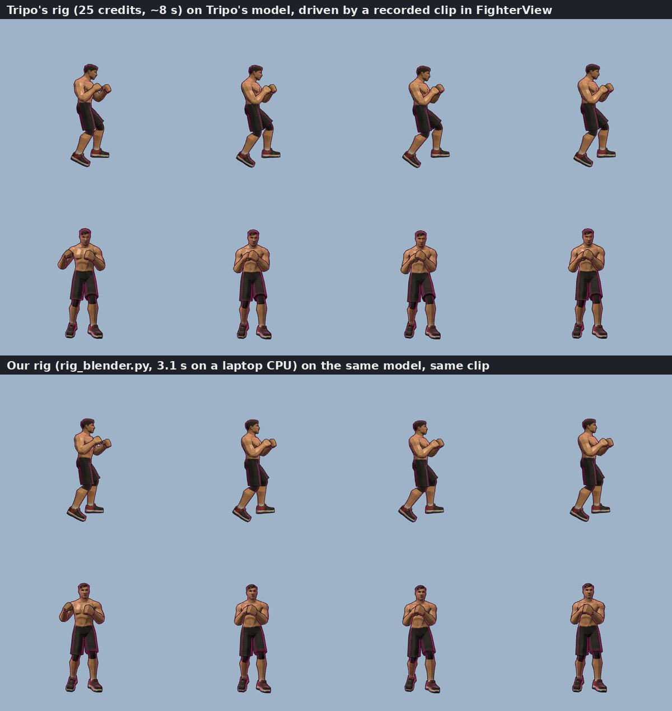

# Forge GPU: our own image-to-3D and rig instead of Tripo

**Goal:** cut the forge's 3D step (Tripo image-to-model + rig: about 85-100 s and 65 credits per fighter, with
about 245 credits left) to under 30 s on a GPU we run ourselves. The game must not change: it gets the same
`rigged.glb` it gets from Tripo.

**Status:** everything is built and tested except the GPU itself. AWS's GPU quota for this account was 0 in every
region; an increase is requested (support case open). A private Hugging Face Space (ZeroGPU or a dedicated A100) is
ready to go as the other host. GPU timings: _pending the first run on real hardware_.

## The pipeline

```
model sheet (1536x2304, SF6 style, A-pose)
  ├─ GPU:  TRELLIS.2-4B  ->  textured PBR mesh (60k faces, 2048 px)          forge/gpu/gen3d.py
  └─ CPU:  MediaPipe Pose on the sheet -> 17 body joints (runs at the same time)   forge/gpu/landmarks.py
then CPU:  Blender 5.2 (headless) -> face +x, 1 m tall, Mixamo skeleton, bone-heat skin  forge/gpu/rig_blender.py
  ->  rigged.glb (mixamorig:Hips ... RightToeBase, opaque PBR material, textures embedded)
```

The forge (`FORGE_3D=local` or `gradio`) sends the sheet there instead of Tripo, with the same `model` → `rig`
steps, and falls back to Tripo on any error, a cold or stopped box (checked in 3 s), or after `FORGE_3D_TIMEOUT`
(90 s). `test/server/forge.test.ts` covers all of these with mocks.

## Model choice: TRELLIS.2-4B

| | Output | Speed (published) | VRAM | License | Verdict |
|---|---|---|---|---|---|
| **TRELLIS.2-4B** (Microsoft, Dec 2025) | textured PBR GLB, one model | H100: 3 s at 512, 17 s at 1024 (cascade), 60 s at 1536 | 24 GB+ | MIT | **picked**: the only open model with textures fast enough |
| Pixal3D (Tencent ARC, 2026) | TRELLIS.2 fine-tune, front + back views | not published | same | MIT | next to try (back view) |
| Hunyuan3D-2.1 / 2mini | shape + separate paint model | paint alone ~60 s+ | 16-29 GB | Tencent community (no EU/UK/KR) | too slow |
| SF3D / SPAR3D (Stability) | textured, under 1 s | very fast | 6-10 GB | community | much weaker, esp. the back |
| TripoSG, Direct3D-S2, Hi3DGen | shape only | | | | no texture |
| Step1X-3D | textured | ~150 s | 27 GB | Apache | too slow |

TRELLIS.2's stock pipeline has two gated or non-commercial parts, swapped for open ones with no change to the weights
the model expects:

- **Image features:** DINOv3 ViT-L/16 from timm's ungated copy (`timm/vit_large_patch16_dinov3.lvd1689m`), not
  Meta's gated `facebook/dinov3-vitl16-pretrain-lvd1689m` (manual approval). They are the same weights under the same license.
  Checked on CPU: our extractor's block loop reproduces timm's own forward exactly (max diff 0.0) at 512 and 1024,
  and the features separate background from body.
- **Background removal:** `ZhengPeng7/BiRefNet` (MIT) instead of `briaai/RMBG-2.0` (non-commercial). It now loads in
  fp16, and TRELLIS.2's wrapper feeds it fp32, so `gen3d.py` casts it back.

Also: TRELLIS.2 defaults to `low_vram` (each model moved onto the GPU only while it runs). On a 48-80 GB GPU we keep
everything resident. It needs about 14 GB of host RAM for its weights, so it can't run on the team's 16 GB laptop (OOM
at load + first stage on the RTX 4070); the GPU hosts have 64-142 GB.

## Rigging: our own Mixamo template fit

Tripo's rig works on uploaded models too (25 credits each), but it would keep the credit problem. The open auto-riggers
don't give Mixamo names out of the box. UniRig's Mixamo template is untrained, and Make-It-Animatable needs a gated
dataset for its template. Our sheets are always a straight-on front A-pose, so a template fit is enough:

1. **Joints from the sheet.** MediaPipe Pose (heavy) finds shoulders, elbows, wrists, hips, knees, ankles and ears on
   all 5 sheets we have (visibility ≥ 0.85, including the bulky SF6 character). If it ever finds no body, average
   A-pose proportions (measured on those sheets) take over.
2. **Onto the mesh.** The sheet's character box maps onto the mesh's front view. Each joint's depth is the middle
   between the mesh's front and back surface there. The model is first turned to face +x (the arm span
   gives the side axis and the feet poke out in front of the shins), scaled to 1 m with the feet on y = 0, like Tripo's.
3. **Skeleton.** The Mixamo hierarchy and `mixamorig:` names (Hips, Spine, Spine1, Spine2, Neck, Head, Shoulder, Arm,
   ForeArm, Hand, UpLeg, Leg, Foot, ToeBase). The spine is spread between the hips and the neck; the hands and feet are
   extended from the wrist and ankle; the head goes up to the top of the mesh.
4. **Skin.** Blender's bone heat on a watertight copy (voxel remesh at 8 mm). Bone heat failed for every bone until
   the copy was cleaned (merge 0.1 mm doubles, dissolve degenerate faces, triangulate, keep the biggest piece).
   The weights then go back to the real mesh (nearest face, interpolated), max 4 bones per vertex.

Rig time is 2.4-3.4 s on a laptop CPU for 7-22k-vertex models, with no vertex left unweighted. The four facings
(0/90/180/270°) all come out right. Driven by the game's own `FighterView` on a recorded clip, our rig on Tripo's
meshes looks the same as Tripo's own rig on them.



_Comparison: sheet | Tripo model | our model, timings: pending the GPU run._

## Hosts

| | AWS g6e.2xlarge | HF ZeroGPU | HF A100 large |
|---|---|---|---|
| GPU | L40S 48 GB | shared (RTX PRO 6000 Blackwell, 96 GB) | A100 80 GB |
| Cost | $2.24/h on-demand (the user's AWS credits) | free with PRO ($9/mo), daily GPU quota | $2.50/h |
| Status | quota 0, increase requested | ready (`hf_space.py`), not created | ready, not created |
| Forge setting | `FORGE_3D=local` | `FORGE_3D=gradio` | `FORGE_3D=local` |
| Code | `setup.sh` + `forge3d.service` + `aws.sh` | `zerogpu/` | `docker-space/` |

**AWS security:** its own security group. SSH only from bingus (73.225.196.193); the service port 8790 only from the
brawlegle box (its security group for the private VPC path, and its Elastic IP) and bingus. The key pair
`brawlegle-gpu` lives only on bingus (`~/.ssh/brawlegle-gpu.pem`). Every call also needs the service key
(`FORGE3D_KEY` in `/etc/forge3d.env`, root only). Everything is tagged `Project=brawlegle`.

**Stop and start:** `bash forge/gpu/aws.sh stop` (the disk and Elastic IP stay, about $0.50/day) and `start` (the
service starts on boot and is ready about 2 min later). On HF: `python forge/gpu/hf_space.py pause`.
