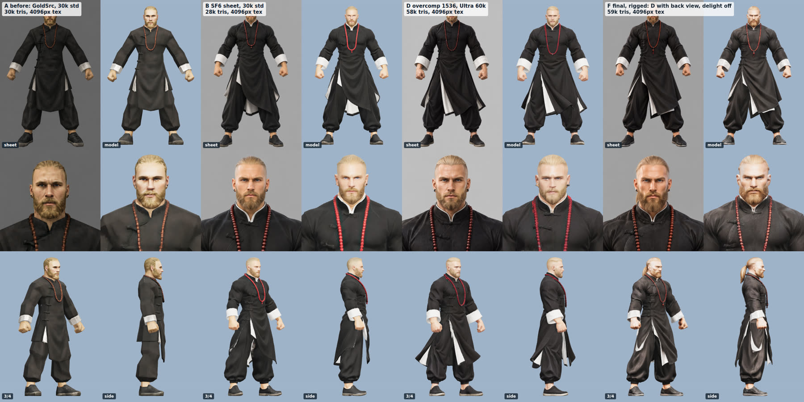
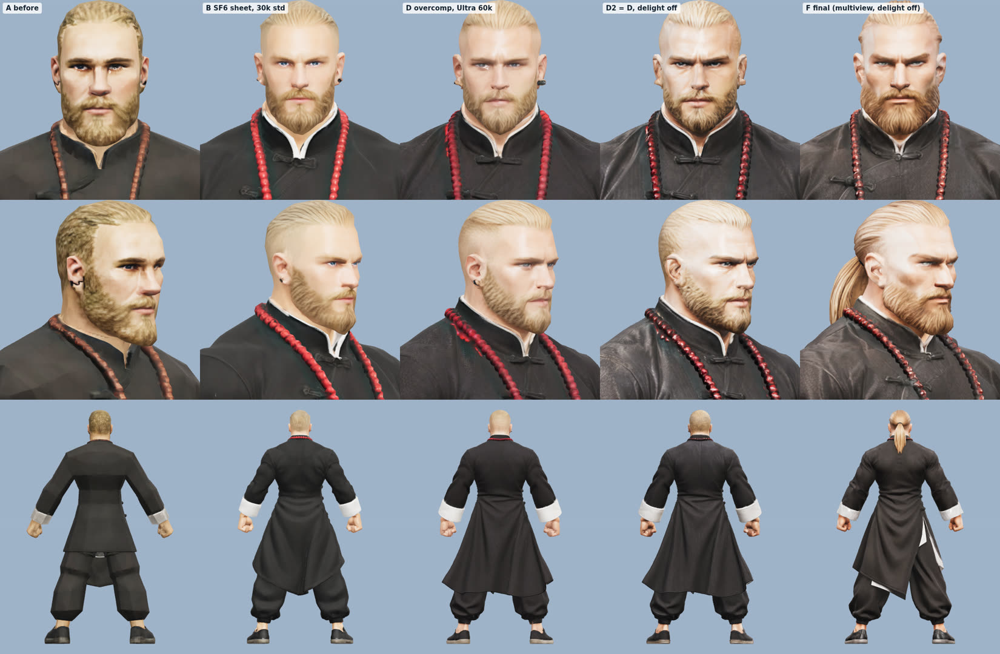
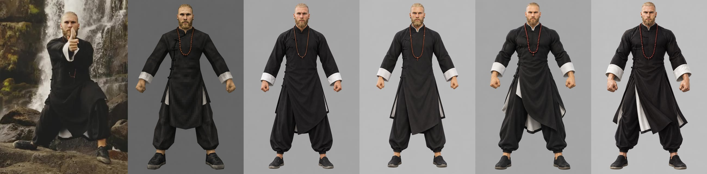
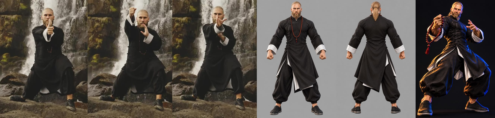
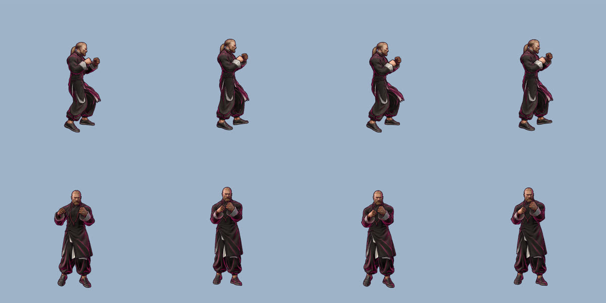

# Forge quality: sharper, livelier fighters from the scan

**Recommendation (shipped as the default):** draw the sheet as a Street Fighter 6 style fighter at 1536x2304, a little
*over*-detailed. Have the image model draw its back view too. Then build the model from front + back with Tripo's
Ultra geometry at 60k faces, keeping the sheet's painted shading (`delight: false`). Rig with v1.0 as before.
A forge now takes about 2.5 min (was about 2) and 85 Tripo credits (was 65). `FORGE_STYLE=goldsrc` brings back the
old forge exactly.

*Each fighter is shown with its sheet next to the model at the same scale (top row: full body, middle row: face), so you can see what the 3D step loses.
Bottom row: 3/4 view and side view. The side view is how the arena camera sees a fighter. A is the old forge, F is the new default, run end to end through the
real server and rigged.*

## Why the models looked bad

Tripo rebuilds whatever the sheet shows, and it loses a bit at every step:

1. **The sheet asked for low detail.** The GoldSrc prompt asks for "low-polygon geometry, flat lighting, pixelated
   256-color textures". Tripo copied it faithfully, giving faceted shapes and a blurry, pixel-mush texture (A).
2. **`delight` (on by default) strips the shading out of the sheet** before texturing. That shading includes the
   painted folds, brows and cheekbones that make a stylized character read. Without it the model looks flat and pale,
   and colors drift: the dark red-brown beads turn candy red (B, D).
3. **One image means the back is invented.** The back is a smooth guess: no hair tie, no costume detail, and a
   blobby side silhouette. That matters because the arena camera looks at fighters from the side.
4. **Standard geometry at 30k faces** rounds off the ears, the nose and the fabric folds.

## What the experiments show

*Rows: face from the front, face at 3/4, body from behind.*

| | Sheet | Tripo settings | 3D time | Credits | Verdict |
|---|---|---|---|---|---|
| A | GoldSrc, 1024x1536 | v3.1, 30k, standard geometry, detailed tex v3.5 (old default) | 76 s | 40 | faceted, pixelated, flat |
| B | SF6 fighter, 1024x1536 | same as A | 90 s | 40 | big jump from the prompt alone; face pale and flat |
| C | same as B | + Ultra geometry, 60k | 102 s | 60 | crisper nose, ears, brows and folds |
| D | SF6 *overcompensated*, 1536x2304 | same as C | 106 s | 60 | sharper face and textures than C |
| D2 | same as D | D's geometry re-textured with `delight: false` | 60 s (texture only) | 20 | keeps the painted shading and true colors; the most sheet-like texture |
| E | same as D, plus a drawn back view | multiview front + back, same as C | 110 s | 60 | real back and ponytail, better side silhouette |
| **F** | fresh run of D's prompt, plus back view | **multiview, Ultra, 60k, `delight: false`**, then rig v1.0 | 102 s + 8 s rig | 60 + 25 | **winner**, end to end through the real server |

Every test used the same scan input: three person crops (440x600 JPEG, like the game's scan crops) from the stock clip
`49576.mp4`, a bearded man in a black kung-fu robe. The pipeline is gpt-5.4-mini brief → gpt-image-2.5-sunburst sheet → Tripo.

### Sheets

*Left to right: scan crop, GoldSrc (old), "detailed" photoreal-ish, clean stylized CG, SF6 fighter, SF6 overcompensated (1536x2304).*

- The first "detailed" prompt came out photoreal: a real man in a costume. Naming the style ("stylized 3D CG render in
  the style of Street Fighter 6 … not a photo") makes a game-model look. Tripo rebuilds that more cleanly, and the
  in-game face doesn't drift into the uncanny.
- **The fighting-game look comes from the brief.** The brief now also returns `outfit`, `archetype` (for example "kung fu master") and three
  `signature` costume details with an accent color. The sheet then exaggerates the build: wide shoulders, V-shaped
  torso, oversized fists, strong jaw and brow, slightly larger head.
- **Overcompensation** asks for more than the model should end up with: painted ambient occlusion in every fold,
  painted highlights on cheekbones, nose, brow, knuckles and hair locks, hard edges between materials, and
  razor-sharp focus. It also uses the largest non-experimental 2:3 size, 1536x2304. The 3D step softens all of this, and what
  survives still reads as detailed. It costs only 3 s over 1024x1536 at medium: 19 s vs 16 s. `high` quality took 27 s
  for little visible gain, so the sheet stays at `medium`.
- **The back view works.** A second sunburst call with the sheet as its only reference ("same character, seen from
  directly behind, same pose, framing and lens") matched the pose, framing and costume all three times (15–22 s).
  Front + back is the safest multiview pair, so left and right views weren't drawn: in an A-pose the side views
  overlap the arms and the torso.
- The card keeps the sheet's look (flare, about 13 s), now as SF6-style select-screen art.

*The end-to-end run (F): scan crops, sheet, back view, card.*

### Rig

F's rigged GLB has 23 joints with every `mixamorig:` bone the retargeter needs (Hips, Spine, Neck, Head,
Left/RightArm, ForeArm, Hand, UpLeg, Leg, Foot). The game's own `FighterView` (current main: bladed stance, rim light, outline hull) drives it cleanly from recorded pose
clips:

The 60k-face multiview model rigged in about 8 s with v1.0, so the newer rigger (`v3.0-20260909`, also Mixamo
naming) wasn't worth a test run's credits.

## Time and credits per forge

| | Before (goldsrc) | After (default) |
|---|---|---|
| Brief | 3 s | 3 s |
| Sheet | 16 s (1024x1536) | 19 s (1536x2304) |
| Card (in parallel with the model) | 12 s | 15 s |
| Back view | none | 20 s |
| Tripo model | about 76 s, 40 credits | about 102 s, 60 credits |
| Rig (v1.0) | 25 credits (time not re-measured) | 8 s, 25 credits |
| **Total** | **about 2 min, 65 credits** | **152 s measured end to end, 85 credits** |
| Rigged GLB | about 7.5–8.5 MB, 30k tris | 10.9 MB, 59k tris, 4096 px PBR textures |

OpenAI per forge: one extra image call for the back view, and a 2.25x larger sheet.
To trim: `FORGE_GEOMETRY_QUALITY=standard` saves 20 credits and about 12 s; `FORGE_MULTIVIEW=0` saves about 20 s; `FORGE_FACE_LIMIT=30000`
halves the triangles if slow laptops struggle. The game now draws an outline hull, so every fighter mesh is drawn twice.

## Tripo settings reference

From the [image-to-model](https://developers.tripo3d.ai/en/docs/generation-image-to-model/standard) and
[multiview-to-model](https://developers.tripo3d.ai/en/docs/generation-multiview-to-model/standard) docs (same
parameters), the [changelog](https://developers.tripo3d.ai/en/docs/changelog),
[models and versions](https://developers.tripo3d.ai/en/docs/models-and-versions), and the
[v3.1 credit table](https://developers.tripo3d.com/en/models/v3-1):

| Setting | Values | Notes | Us |
|---|---|---|---|
| `model` | `v3.1-20260211` (latest H), `v3.0-20250812`, `v2.5-20250123`; P series `P1-20260311`, `P2-20260801` | P1/P2 are the low-poly series (P2: 100–130 credits, triangles ≤ 50k) | v3.1 |
| `geometry_quality` | `standard`, `detailed` (= "Ultra") | v3.0+; +20 credits | detailed |
| `face_limit` | v3.1 up to 1.5M (Ultra 2M); omitted means adaptive | docs suggest 50–100k for game assets and 10–50k for web | 60k |
| `texture_quality` | `fast`, `standard`, `detailed`, `extreme` (8K) | `fast` needs texture v3.5; `extreme` costs extra | detailed (4096 px) |
| `texture_version` | `v3.5-20260815` (newest), `v3.0-20250812` (default for v3.x), `v2.5-20250123` | v3.5 adds `fast` and `delight` | v3.5 |
| `delight` | `true` (default) / `false` | v3.5 only. Removes the lighting baked into the input. Off keeps a stylized concept's painted shading (also recommended in [Scenario's Tripo guide](https://help.scenario.com/articles/4692888910-tripo-family-the-complete-guide)) | false |
| `texture_alignment` | `original_image` (default) / `geometry` | `original_image` means match the sheet's colors, which is the goal | default |
| `pbr` / `texture` | default true | | true |
| `orientation` | `default` / `align_image` | | default (the game turns models -90°) |
| `export_orientation` | `+x` default | the docs warn not to set it before rig/texture steps | unset |
| `quad` | false | forces FBX output (the game loads GLB); +5 credits | off |
| `smart_low_poly` | false | hand-made topology, 500–20k faces; +10 credits | off |
| `generate_parts` | false | untextured parts only; +20 credits | off |
| `compress` | `geometry` (meshopt) | the game's GLTFLoader has no meshopt decoder | off |
| `auto_size` | false | real-world meters; the game scales fighters itself | off |
| `enable_image_autofix` | false | upscales and fixes weak inputs; the sheet is already clean | off |
| `model_seed` / `texture_seed` | int | same geometry, new texture: fix `model_seed` | unset |

**Credits** (v3.1 page, confirmed by `credits_consumed`): image or multiview to 3D costs 20 without texture, 30 with standard texture
and 40 with detailed texture; detailed geometry adds 20, quad 5, smart low-poly 10, parts 20.
Re-texturing an existing model ([`/models/texture`](https://developers.tripo3d.ai/en/docs/models-texture)) cost 20
at detailed quality. A rig ([`/animations/rig`](https://developers.tripo3d.ai/en/docs/animations-rig)) costs 25, and rig-check is free.

**Multiview** takes `inputs: [{front}, {left}, {back}, {right}]`. The front is required and at least 2 views are
needed. It costs the same as a single image.
Tripo also has [`image-to-multiview`](https://developers.tripo3d.ai/en/docs/generation-image-to-multiview), which
draws the 4 views for you. It wasn't used: its price isn't documented, and the image-generation category allows only 1
concurrent task per account ([rate limits](https://developers.tripo3d.ai/en/docs/rate-limits)), so parallel forges
would queue. Our own back view from sunburst matches the sheet's style exactly anyway.

**Rig:** `v1.0-20240301` (biped, the default), `v2.5-20260210` (non-humanoid), and `v3.0-20260909` (faster
humanoid rig, opt-in, adds `spec` actorcore/unity/unreal/vrm and keeps mixamo). Scenario's guide suggests keeping rig
inputs under 300k polygons.

**OpenAI images** ([prompting guide](https://developers.openai.com/api/docs/guides/image-prompting)): gpt-image-2.5
flare and sunburst take `quality` from low to max and any `WxH` up to 3840 px per edge (multiples of 16, ratio ≤ 3:1,
≤ 8.29 MP; above 3.69 MP is experimental). 1536x2304 is the biggest non-experimental 2:3 size.

## Not tried, worth a look later

- `texture_alignment: geometry`. The docs frame `original_image` as "match the input", which is what we want, but it's untested.
- Rig `v3.0-20260909` with `spec: mixamo`. It might deform cloth better, but v1.0 is already fast.
- A second subject. Only one scan was run through Tripo. The prompts are generic (the brief fills in the person), but it's
  worth a glance at the first few real forges, especially hoodies and glasses.
- Style references: art writing about SF6 ([Game Informer's design breakdown](https://www.gameinformer.com/2022/11/23/street-fighter-6-art-director-breaks-down-each-revealed-character-design),
  [a critique of its realism vs anime mix](https://entechtainment.substack.com/p/20-06-2022)) describes the look as
  semi-real rendering with anime-exaggerated anatomy and painterly effects. The prompt asks for exactly that.

## Budget used

- 6 Tripo generations (A, B, C, D, E, F), 1 re-texture (D2) and 1 rig: 365 credits. The balance went from 610 to **245**,
  which is about 2 forges at the new 85 credits. **Top up before the demo.**
- 13 OpenAI image calls: 7 sheets, 2 back views and 1 card in the experiments, plus the end-to-end forge's sheet, back view and card.
