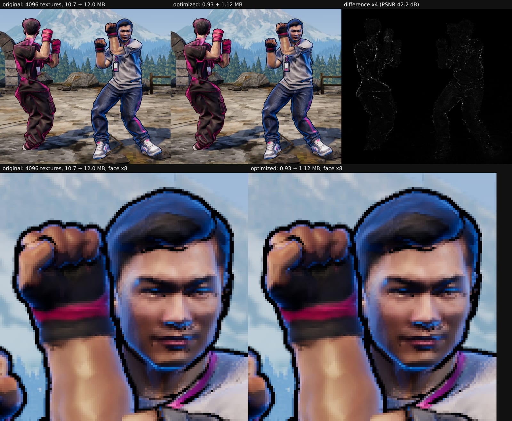
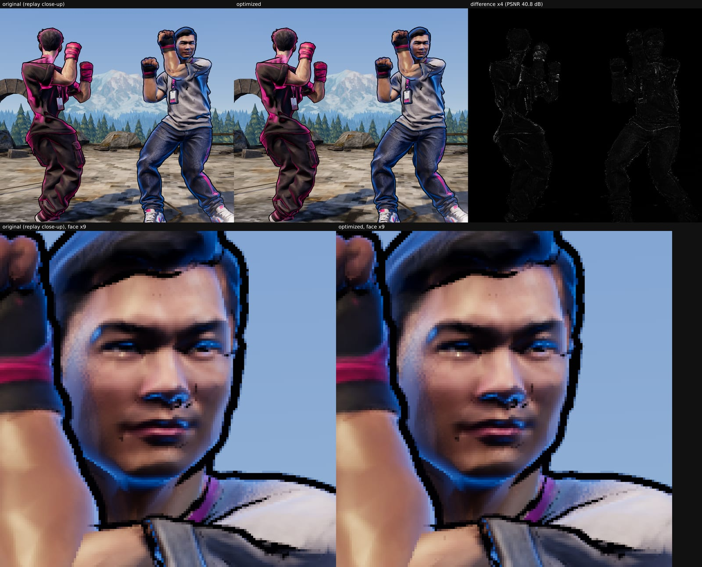
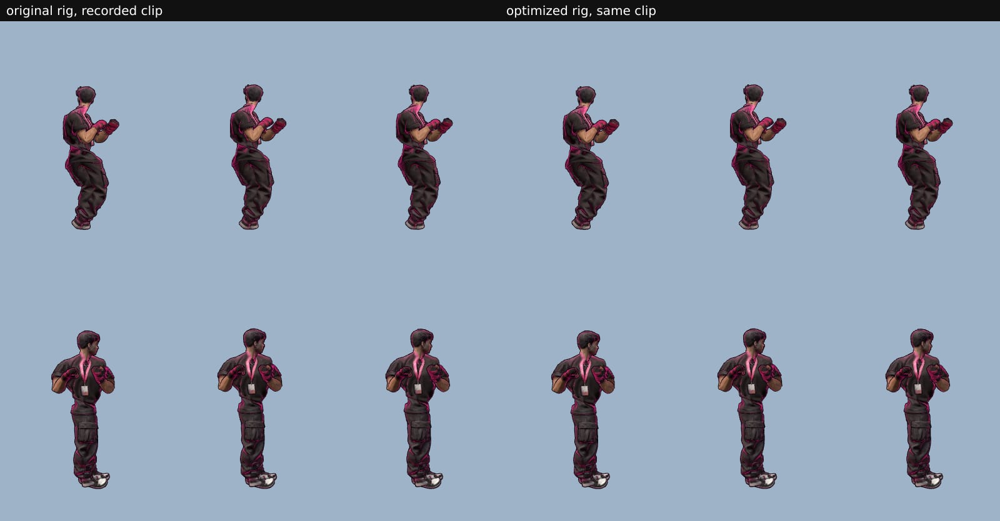
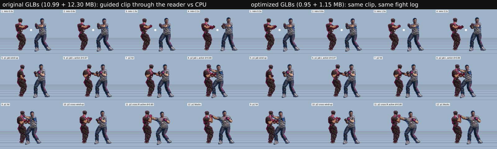
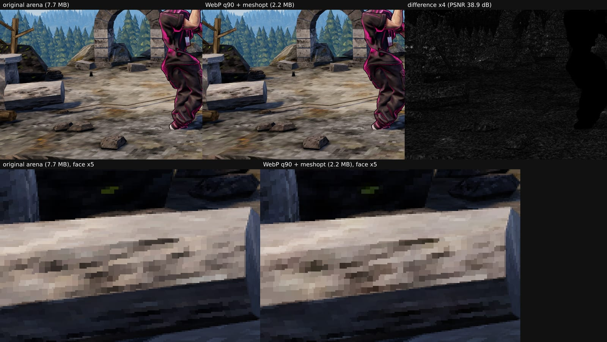

# Load time and assets (perf-assets)

**Bottom line.** A CPU match used to download about 37 MB before both fighters were on screen: two 10–12 MB fighter
GLBs, a 7.7 MB arena, 1.2 MB of uncompressed JS and 2–4 MB of PNG cards. It now downloads about 5.5 MB. The
fighters went from 23.3 MB to 2.0 MB per match with no visible difference in the game's own renders. GPU texture
memory per fighter went from 256 MiB to 32 MiB. On a 10 Mbps / 50 ms link, "Fight as" to the VS screen took 60–71 s
before and takes 1–6 s now; the title screen shows in about 1 s instead of 2. MediaPipe's 13 MB (pose model + wasm) now
downloads under the title screen instead of after "Fight as".

Branch `perf-assets`, rebased on main `bf1833c`. Integrator steps are [at the end](#integrator-steps).

## What changed

| Where | Change |
|---|---|
| `forge/optimize.js` (new) | gltf-transform + sharp + meshoptimizer. Fighter GLB textures are resized (base color 2048, normal 1024, metal/roughness 1024) and re-encoded as WebP. Geometry gets meshopt compression (`EXT_meshopt_compression`: 8-bit octahedral normals, 14-bit UVs, 8-bit weights, float positions). Unused data is pruned, but every node, leaf bone, skin and name stays. Cards and sheets also get WebP copies. |
| `forge/pipeline.js` | Two lines: `optimizeFighter(store.dir, job)` runs just before `status = "ready"`, so no browser ever caches a 10 MB original. It never throws; without its packages it logs a warning and skips. |
| `forge/server.js` | Serves `card.webp`/`sheet.webp`. `cardUrl`/`sheetUrl` point to them once they exist. `store.dir` is exposed. Backups are not served. |
| `forge/optimize-all.js` (new) | One-off batch for the fighters already on the server. Each GLB is replaced in place, so URLs and `fighter.json` stay the same, and the original is kept as `rigged.orig.glb`. Safe to rerun. |
| `forge/deploy/setup-forge.sh` | Copies the new files and runs `npm ci --omit=dev`, which installs sharp's prebuilt arm64 libvips. `MemoryMax` goes from 400M to 600M, because one optimization peaks at about 225 MB RSS. |
| `src/forge/models.ts` (new) | All GLB loads share one `GLTFLoader` with the meshopt decoder (three's 29 KB addon). `preloadModel()` downloads once, and `loadModel()` reuses the bytes. `FighterView`, `Arena` and `Hills` call it (a one-line change each). |
| `vite.config.ts` | A build-only plugin runs the same optimizer on the arena GLBs (`models/*.glb`), so re-baking in Blender needs no extra step. three and react go in their own cached chunks. |
| Preloads | The pose model and MediaPipe wasm are fetched at low priority 300 ms after start (`preloadPose`), with `preconnect` hints for both CDNs. A saved fighter's GLB starts when the "Welcome back" card appears, or after a 300 ms hover on the roster. It also downloads in parallel with the camera start instead of after it. In practice mode, the CPU's fighter is picked and downloaded once the player's name is known. Announcer clips load at low priority. |
| `matchmaker/deploy/setup.sh` | nginx: `gzip` for JS, CSS, JSON, wasm and GLB (Ubuntu's default only gzips HTML, so the 1.2 MB bundle went out raw), plus `http2` on the TLS listener. |

## Fighters

Six fighters from the live server, before and after `optimize-all.js`. Parse time is GLTFLoader's `parseAsync` in
headless Chromium (median of 3): meshopt decode plus texture image decode. GPU memory is RGBA8 with mips.

| Fighter | Style | Triangles | GLB before → after | Textures before → after | GPU textures | Parse |
|---|---|---|---|---|---|---|
| rico | new (Tripo v3.1) | 38.2k | 10.99 → **0.95 MB** | 4096 PNG + 2×4096 JPEG → 2048 + 2×1024 WebP | 256 → **32 MiB** | 773 → 242 ms |
| dylan | new | 39.1k | 12.30 → **1.15 MB** | same | 256 → 32 MiB | 951 → 249 ms |
| e2e-mvd3igm9 | new | 29.0k | 7.86 → **0.61 MB** | same | 256 → 32 MiB | 580 → 147 ms |
| bred | old (goldsrc) | 5.8k | 1.09 → 0.29 MB | 2048 JPEG → 2048 WebP | 21 → 21 MiB | 89 → 101 ms |
| demo | old | 5.7k | 1.16 → 0.36 MB | same | 21 → 21 MiB | 94 → 119 ms |
| e2etest2 | old | 6.1k | 1.20 → 0.35 MB | same | 21 → 21 MiB | 101 → 116 ms |
| **all six** | | | **34.6 → 3.7 MB** | | | |

| Card / sheet (served as WebP, PNG kept) | Before | After |
|---|---|---|
| card, new style (1024×1536) | 2.00 / 2.19 MB | 0.12 / 0.16 MB |
| card, old style | 1.36–1.55 MB | 0.04–0.05 MB |
| sheet, new style (1536×2304 → 1024×1536) | 3.63 / 4.00 MB | 0.06 / 0.08 MB |

The memory-card screen shows every fighter's card in a grid. With 50 fighters that grid would have been about 85 MB
of PNGs; as WebP it is 2–8 MB.

Where the bytes were: in a new-style fighter, textures are 9.6 of the 11 MB (a 5 MB lossless 4096 normal map
alone). Geometry is 1.4 MB, and meshopt brings it to about 0.35 MB.

### Is it visibly different? Renders in the game's own scene

These renders use `test/scratch/perfshot`: the real `Renderer` (arena, sky light, sun shadows, bloom, ACES, ink
outlines, rim light) and `FighterView`, with seeded randomness so poses match exactly. On the left is the original,
in the middle the optimized fighter, on the right the difference ×4, with an enlarged face below each.

Fight camera (rico + dylan), PSNR 42.2 dB over the fighters (0.6% of pixels off by more than 8/255):



K.O. replay sweep, mid-swing. This is the closest the camera ever gets: fighters fill about 90% of the frame. PSNR
40.8 dB:



Textures alone (2048 + 1024 WebP) differ from the 4096 originals by 50.4 dB, which is invisible. Even 1024 base
color holds up at the close-up (40.3 dB, [image](perf-assets/fighters-closeup-1024.jpg)) and would save about
0.3 MB more per fighter. I kept 2048 as the margin for 1440p and 2× displays.

**One thing that did show:** quantizing *positions* (gltf-transform's default) thinned the ink outline by about a
pixel ([image](perf-assets/quantized-positions-outline.jpg), 25 dB). The outline is pushed out along the normals in
the mesh's local units, and quantization rescales those units into the skin's inverse bind matrices. So positions
stay float. That costs about 0.1 MB per fighter, and the outline is now identical.

### The rig still animates the same

Recorded tuner clip (`pose-230837.jsonl`) through `FighterView` + `SkeletonPose` (`retargetshot`), original vs.
optimized rico: 48.3 dB, the same poses.



The guided clip (`guided-233104.jsonl`) through the IntentReader → Resolver → FightEngine vs. a seeded CPU, on both
fighters (`fightview`). The fight log is identical (jab, hit, cross, block…), and the frames match at 45.9 dB:



`test/server/optimize.test.ts` checks the same on a synthetic two-bone skinned mesh. Node names, joint order,
inverse bind matrices and rotations come out bit-identical, positions are exact, each joint's weight is within 1/255,
and UVs are within 1/16000. A second run is a no-op.

## Arena

| | Before | After (build plugin) |
|---|---|---|
| `floating_island.glb` (3.7k tris, 2048 baked atlas) | 3.47 MB | 0.70 MB |
| `forested_hills.glb` (36.7k tris, 2048 baked atlas, 73.6k verts) | 4.26 MB | 1.50 MB |

Textures stay 2048. They are sampled with nearest filtering for the PS2 look, so resizing would change the pixels.
They are WebP q90 instead of PNG. Geometry is meshopt-compressed but decodes to the same float positions and UVs:
`Hills.ts` instances and simplifies the bare geometry (main's new LOD worker reads the raw UV array), and
`Arena.ts` reads positions to fix inside-out parts. Normals become 8-bit, which nothing reads directly. Whole
frame: 41.0 dB; at 5×, texels shift by a level or two:



## JavaScript

| | Before (`337e446`) | After |
|---|---|---|
| Initial JS | one 1,222 KB chunk, **served uncompressed** | index 228 + react 219 + three 666 KB = 1,113 KB, **310 KB gzipped** |
| MediaPipe JS | inside the main chunk | its own chunks (main's pose worker; the page fallback loads it lazily) |
| After a redeploy | the whole 1.2 MB again | only the game's own chunk (about 73 KB gzipped); three and react stay cached |

## Page load on a slow network

Method: `test/scratch/bench/run.mjs`. A local stand-in for the box serves the static build like nginx, with `/api/`
proxied to the real `forge/server.js` (OpenAI/Tripo mocked) on a copy of the rico and dylan fighters. Network is
throttled through CDP to 10 Mbps down, 5 up, 50 ms RTT, with an empty cache. The flow is Practice → Enter → "rico"
→ Fight as (2 s of think time on the title and on the card), then the CPU (dylan). The marker is VsIntro's VS slam,
when both fighters have spawned. `?input=mock` isolates asset loading from MediaPipe's start-up, which takes 60+ s
in SwiftShader.

| (10 Mbps, 50 ms) | Before: `337e446`, nginx as live | After: this branch + gzip |
|---|---|---|
| Title screen | 2.05 s, 2.10 s | **0.89 s, 1.08 s** (1.43 s without gzip) |
| "Fight as" → VS (both fighters in) | 60.0 s, 71.3 s | **1.3 s, 5.7 s** |
| Downloaded by then | 35–37 MB | 5.3 MB |
| … fighter GLBs | 23.29 MB | 2.00 MB |
| … arena | 7.86 MB | 1.89–2.09 MB |
| … game JS/CSS | 1.27 MB | 0.31 MB |
| … cards/sheets | 2.0–4.2 MB | 0.28 MB |

Same comparison on today's main (`bf1833c`) vs. the rebased branch: "Fight as" → VS **59.8 s → 0.9 s and 1.4 s**,
with 35.2 → 5.6 MB downloaded.

How to read these numbers:
- The fighter download alone is about 19 s at 10 Mbps before and 1.6 s after. The rest of the "before" time is
  SwiftShader (the CPU) uploading and mip-mapping six 4096² textures. A real GPU does that in well under a second,
  so expect about 20–25 s before vs. 1–2 s after on real laptops.
- After the rebase, the title came in at 3.7 s instead of 1 s in SwiftShader, and this is not a network effect. The
  arena is now small enough to arrive about 2 s in, and adding it to the scene (shader compiles, shadow map, main's
  new hills-LOD worker) lands on the CPU during the title's first paint. With the original-size arena swapped into the
  same build, the title is back at 0.98 s. On a GPU this costs about 100–200 ms. **Suggestion for the rendering
  side:** the 3D scene keeps rendering behind the opaque title and avatar screens. Pausing it there, or adding the
  arena to the scene when the title is left, would remove that cost and save battery.
- Camera path (fake webcam, so MediaPipe really loads): before, the pose model + wasm (13 MB) only started after "Fight
  as" and finished 13.0 s later. Now they start under the title screen and finish 14.5–15.5 s after page load. A player
  who spends 15 s or more in the menus waits for none of it. MediaPipe's loader in main's new pose worker gets the
  wasm and the model from the HTTP cache. I checked this with `test/scratch/cachetest`: a persistent profile takes
  37 ms instead of about 600 ms. **One caveat:** in an incognito window Chrome's in-memory cache doesn't keep the
  9.4 MB model, so the worker downloads it again. The fix is to pass the preloaded bytes to the worker as
  `modelAssetBuffer` (a small change to main's `poseWorker` init message); I left it out because that file was just
  rewritten on main.

## Not done, and why

- **KTX2/Basis textures.** These would cut GPU memory a further ~4–6×. GPU memory is already 8× lower (32 MiB per
  fighter), and KTX2 needs `toktx`/basisu on the arm64 box plus a 600 KB transcoder in the game. Worth it only if
  a weak laptop runs out of GPU memory.
- **Draco.** meshopt gives similar sizes for skinned meshes, with a 29 KB decoder that three ships. Draco needs a
  hosted wasm decoder and decodes more slowly.
- **Simplifying fighters.** 30–40k triangles is cheap to draw, and after meshopt the geometry is only about 0.35 MB.
- **Self-hosting the pose model.** gzip only saves 11% (it's a zip of float16 TFLite), and Google's CDN is fast.
- **Brotli.** It needs nginx's brotli module (`libnginx-mod-http-brotli-*`). It would trim the JS by about 15% more
  (310 → about 265 KB); gzip already gets most of it.
- **Lazy-loading debug UI and the leaderboard.** That's about 10–20 KB; not worth the churn.

## Integrator steps

Order matters only for 1 → 3. The game must be able to read the new fighters before they exist.

1. **Game first.** Merge `perf-assets`. Run `npm ci`, which installs the new devDependencies (`@gltf-transform/*`,
   `meshoptimizer`, `sharp`) that the build uses on the arena. Run `npm run build`. The log should show
   `[plugin brawlmegle:optimize-glbs] assets/floating_island-….glb: 3.47 -> 0.70 MB`, plus a line for the hills.
   If the packages are missing, it warns and ships the originals. Copy `dist/` to `/var/www/brawlegle/game` as
   usual. The new loader reads both old and optimized GLBs. A tab left open from before this deploy can't decode an
   optimized fighter: it falls back to the joint-sphere placeholder (`Game.loadFighter`), so ask people to reload.
2. **Forge.** Copy `forge/` to the box (now with `optimize.js`, `optimize-all.js` and `package-lock.json`) and run
   `sudo deploy/setup-forge.sh`. It runs `npm ci --omit=dev` in `/opt/brawlegle/forge`, which brings sharp's arm64
   prebuilt, and sets `MemoryMax=600M`. Check `curl -s 127.0.0.1:8787/health`. Every new forge now records
   `timings.optimize` in its `fighter.json` (about 2 s here; expect 4–6 s on the t4g.micro).
3. **Existing fighters** (after 1 and 2):
   ```
   cd /opt/brawlegle/forge
   sudo -u brawlegle node optimize-all.js --dry-run /var/lib/brawlegle/forge   # lists what it would do
   sudo -u brawlegle node optimize-all.js /var/lib/brawlegle/forge
   ```
   It works one fighter at a time (about 225 MB peak), prints before → after per fighter, keeps every original as
   `rigged.orig.glb`, and skips fighters already done (`--force` redoes them from the originals). No restart is
   needed: the server streams the swapped file and points cards at the `.webp` as soon as it exists. To undo one
   fighter: `mv rigged.orig.glb rigged.glb && rm -f card.webp sheet.webp` in its folder.
4. **nginx** (any time). Rerun `sudo DOMAIN=… TURN_DOMAIN=… deploy/setup.sh` from `matchmaker/` with the same values
   as the original setup. That also restarts the matchmaker, so do it between matches. Alternatively, add the
   `gzip …` lines and `http2` on the `listen 127.0.0.1:8443 ssl` line in
   `/etc/nginx/sites-available/brawlegle-https.conf` by hand, then run `nginx -t && systemctl reload nginx`. To
   check: `curl -sI -H 'Accept-Encoding: gzip' https://54-149-60-196.sslip.io/assets/<index>.js | grep -i
   content-encoding` should say `gzip`.

## Reproducing

All of these are git-excluded scratch scripts in `test/scratch/`. Run them with
`CHROME_PATH=$(ls -d ~/.cache/ms-playwright/chromium_headless_shell-1223/*/chrome-headless-shell)`.

- `node test/scratch/perfshot.mjs <out> --a orig1.glb,orig2.glb --b opt1.glb,opt2.glb [--arena dir]` renders the
  game scene, writes the PNGs and reports parse time and texture memory.
- `node test/scratch/parse.mjs out.json a.glb b.glb …` reports parse time, GPU texture memory and triangles.
- `node test/scratch/bench/run.mjs out.json --dist <build> --data <FORGE_DATA> [--gzip] --port 4473 --query
  '?input=mock&quality=low'` runs the throttled load benchmark. Build with `VITE_FORGE_API=http://127.0.0.1:4473
  VITE_SIGNAL_URL=`.
- `node test/scratch/retargetshot.mjs <clip> <glb> 2,4,6 out.png` and `fightshot.mjs` check the rig.
- `node forge/optimize-all.js --dry-run <dir>` and `npx vitest run test/server` cover the optimizer.
